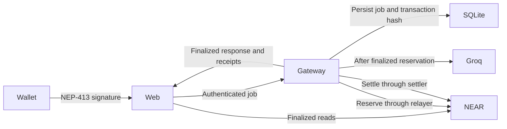

# QuotaCarry submission notes

**Track:** NFTs That Do Something · **Project:** QuotaCarry · **Pitch:** Transfer AI compute rights, not API keys.

API keys are difficult to transfer safely and do not carry a portable, auditable allowance. QuotaCarry represents an issuer-funded credit balance as a NEAR NFT. The NFT transfers the ability to request new credits. Reservations opened before a transfer retain their original identity and can still settle.

- Repository: [QuotaCarry](https://github.com/nevan-sonic/QuotaCarry)
- Contract: [quotacarry-fund-7b29e1.testnet](https://explorer.testnet.near.org/accounts/quotacarry-fund-7b29e1.testnet)
- Demo token and policy: both 0
- Evidence: [transfer](https://explorer.testnet.near.org/transactions/davp7Z7GTM4FBzRxKLyAFRhJSf6moJg49K5dN3PZxiQ), [stale owner rejected](https://explorer.testnet.near.org/transactions/2cUdDxFQT3cbAjexjxE6MgYNgkFPVFe3wy2MtnrADb8t), [Bob reserved](https://explorer.testnet.near.org/transactions/8nT3aUGXtz57Zw8Bs4JefpaFAHcdLuxNtczndRvvZgEF), [final settlement](https://explorer.testnet.near.org/transactions/J7TceTF9PqfMM1MREFnnVs59FLF6zNnjddJoBHwXgNRK)
- Public application: [QuotaCarry](https://quotacarry-web.quotacarry.workers.dev/). Gateway: [health endpoint](https://quotacarry-gateway.quotacarry.workers.dev/health). Recorded demo: pending.

NEAR supplies standard NFT ownership and transfer, explicit role accounts, finalized receipts, and an independently readable ledger. The relayer is issuer-operated and trusted to authenticate users. See [threat model](THREAT_MODEL.md).

## Recording plan

| Time | Shot and narration |
|---|---|
| 0–15s | Open the landing page and explain how the NFT carries a bounded allowance without sharing the issuer API key. |
| 15–40s | Show finalized RPC data for token 0. Point out Bob, epoch 1, 98 available, zero open and two consumed. |
| 40–70s | Open the historical transfer and stale-owner rejection links. Explain why Alice's existing reservations survived but her next request failed. |
| 70–90s | Show Bob's reserve and final settlement. Explain 100 = 98 + 0 + 2 and identify which features were verified live. |
| 90–150s (extended) | Show the deployed contract, role separation, and how the intended gateway gates provider work on finalized reservations. Keep the current inference status visible. |

Suggested screenshots: landing page with contract link, dashboard showing the finalized block, and transfer receipt showing Alice and Bob. Label the earlier transaction sequence historical. Do not record account credentials.

Before submission, confirm the current rules and form at the [official hackathon site](https://nearhackathon.com/). Prepare project title, lead/contact, team size, NEAR account, repository, demo post link, and short description. Publish actual screenshots or video and tag @NEARProtocol and #NEARHackathon as directed by the official site. Submission and external posting are pending.

## Operational handoff

Install workspace packages with `npm ci`. Run `npm run lint`, `npm run typecheck`, `npm test`, and `npm run build`. Start the production frontend with `npm exec -w @quotacarry/web -- next start`. Start the gateway health server with `npm run start -w @quotacarry/gateway` after building.

The frontend reads snapshots from finalized testnet RPC with read-only failover, refreshes every 20 seconds, and checks the final receipt after a wallet transfer. The local production API returned the expected token state and independently resolved the historical transfer. An app-initiated wallet transfer still needs a live browser test with a separately approved transaction.

The authenticated gateway and playground are implemented. The frontend and gateway are deployed on Cloudflare Workers. One production inference run is verified below.

## Gateway deployment and recovery

The gateway exposes /health for process liveness and /ready for configuration status. Run one gateway process with a persistent volume for QC_DB and its SQLite WAL. Set QC_ORIGIN to the exact frontend origin. Build the web app with NEXT_PUBLIC_QC_GATEWAY set to the public gateway HTTPS URL. Set GROQ_API_KEY, GROQ_MODEL, QC_RELAYER_KEY and QC_SETTLER_KEY using the gateway host secret manager. Keep the database private because it contains model output. Choose QC_POLICY_ID explicitly. The supplied testnet deployment can serve policy 0 only after separately authorized signer and provider configuration.

The wallet signs a NEP-413 challenge bound to the frontend domain, testnet, inference action and a two-minute nonce. The gateway verifies the finalized account key and stores a hash of the short-lived bearer token. A unique job per token and a single active worker serialize requests. The provider call occurs after finalized reservation verification. The worker records a transaction hash before each broadcast and reconciles ambiguous sends by read-only hash queries. On restart it can resume a settlement that was durably selected and had no settlement hash. A reserved job interrupted before or during provider execution can require operator reconciliation. Resolve ambiguous provider outcomes before releasing credits. Keep one worker instance to preserve signer nonce ordering.

Live Groq verification succeeded. Browser wallet signing remains pending. Issuer 0 has no remaining mint capacity. Preserve the historical NFT and obtain separate authorization for any testnet writes used to verify the deployment.

Deploy the web workspace as a Next.js server and the gateway as a single Node process behind HTTPS. Use the repository Node pin, build from the monorepo root, set GATEWAY_HOST to the private interface exposed to the HTTPS proxy, and mount a persistent private directory for QC_DB. Verify both health routes and an authenticated testnet request before announcing a live URL. Keep backups and restrict access to the database and signer secrets.

## Verified production inference

On November 14, 2026 the public Cloudflare gateway completed one free Groq request with `openai/gpt-oss-20b` and a 512-completion-token cap. The NEP-413 proof was signed by Bob's real testnet key using the local signer. The gateway accepted it and rejected nonce replay. Browser wallet signing was outside that verification.

Prompt: “In one short sentence, explain why a transferable credit is different from sharing an API key.”

> A transferable credit is a movable unit of value that can be passed between accounts, while sharing an API key gives direct, credential-level access to the system.

Production D1 job `782dc845-ae18-448d-a14f-56e936e7ebcd` completed. The scheduled Worker finalized the reservation before invoking Groq and finalized consumption before returning the response. Inference was disabled after this single authorized request.

| Action | Finalized NEAR testnet receipt |
|---|---|
| Register issuer 1 | [8BLiycS…](https://explorer.testnet.near.org/transactions/8BLiycSVucobeoycdv6tWtMB9xFnuSA1LZr1cpKLQ2cD) |
| Create policy 1 | [2nDaQgP…](https://explorer.testnet.near.org/transactions/2nDaQgPGe5uXDfs1d9MjKYqNRLpXDP43Ui3YHkTanSRN) |
| Mint token 1 to Alice | [6gbCUQ4…](https://explorer.testnet.near.org/transactions/6gbCUQ44dVQjLuFsF9Ztq97YgivmCpD7aARjUY6wb9SQ) |
| Transfer token 1 to Bob | [BAEkip9…](https://explorer.testnet.near.org/transactions/BAEkip9bsg4oNseLdKsGGMw1CWbqgBuDFP25UPKZHVSe) |
| Reserve sequence 0 for Bob | [6T5r6ke…](https://explorer.testnet.near.org/transactions/6T5r6kekc3tBNW3Dvd2bCdj7ytKByYFEA2iqaoDr9axL) |
| Consume sequence 0 | [9DdoWEF…](https://explorer.testnet.near.org/transactions/9DdoWEFv4hpfdU7Vqvom7Vg4Ge7uqF3t7WvCxZbxwwsM) |

At finalized block 277634713, Bob owned token 1 at epoch 1 and policy 1 conserved one issued credit as zero available, zero open and one consumed. Historical token 0 was unchanged. Fees totaled 0.0015959326134594 NEAR. Deposits totaled 0.060000000000000000000001 NEAR. Aggregate spending was 0.061595932613459400000001 NEAR.

For the recording, show the completed production response as verified historical evidence alongside the reservation and consumption receipts. Use the public dashboard for current finalized state. Interrupted signed-job recovery still needs a dedicated test.
