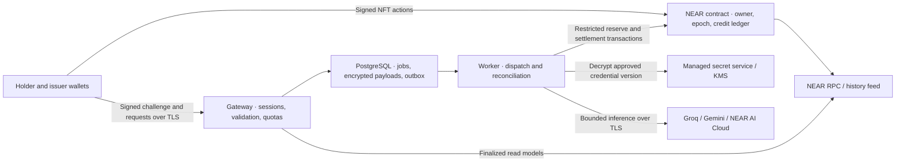

# QuotaCarry architecture and implementation plan

Planning baseline · 13 November 2026 · Testnet-first

The [Phase 0 risk ADR](ADR-0001-FOUNDATION.md) governs the restricted-relayer trust boundary, the reservation permit evaluation, and the NEP-171 compatibility gate. The [Phase 0 verification report](PHASE_0_VERIFICATION.md) records observed checks and open assumptions.

## A. Official requirements audit

- The live rules give the deadline as **14 November 2026 at 23:59 UTC** (15 November at 05:29 IST). Development eligibility starts at the 19 October announcement, submissions opened 1 November, judging starts 16 November, and results are due by 18 November at 23:59 UTC. Final submission is registration. The repository must be public by the deadline and through judging. Include a license, reproducible numbered README steps, baseline disclosure when applicable, and disclose starter libraries/templates. Testnet-only entries qualify. [Live rules](https://nearhackathon.com/HACKATHON.md) · [Event site](https://nearhackathon.com/)
- The human publishes a public X post saying the project was built at NEAR HACKATHON, with @NEARProtocol, #NEARHackathon, and attached video or screenshots. A local-only demo requires video. Hosting is encouraged and QuotaCarry requires it as a product acceptance criterion. Keep the hosted flow up through judging, ideally through 25 November. [Live rules](https://nearhackathon.com/HACKATHON.md)
- One submission per project and repository. One person may submit up to two independent projects with mutual README disclosure. The starter checklist's one-per-team shorthand and implication of no correction route are less precise than the live rules. The human can request reviewed changes. AI screens reproducibility and features. Humans decide winners. [Starter checklist](https://github.com/nearai/near-hackathon-prompt-examples/blob/main/SUBMITTING.md) · [Live rules](https://nearhackathon.com/HACKATHON.md) · [Change request](https://nearhackathon.com/request-changes)
- Collect human-confirmed project name, lead name, contact email, team size, all applicable track IDs, human-created mainnet payout account, public repo URL, public demo post URL, 20–2000 character description, and consent. Read the organizer's contact notice verbatim at submission time. The API accepts only `requestId, projectName, leadName, email, size, tracks, nearAddress, projectUrl, demoUrl, idea, consent`, with a 12,000-byte JSON limit. Use one UUID for the same submission. Validate name lengths (2–80), email (≤160), URLs (≤300 each), size enum and payout account syntax against the live rules. Show full payload and obtain explicit confirmation before POST. Keep it outside Git. A 201 confirms success, 403 stops retries, 409 requires inspection and potentially the human change-request route. Reuse the UUID on network failure or 503, with the specified one-minute delay for 503. Reconfirm changed payloads for 400/413. [Submission instructions](https://nearhackathon.com/HACKATHON.md) · [Application form](https://nearhackathon.com/#apply) · [API destination](https://nearhackathon.com/api/applications)
- Get explicit confirmation before publishing/pushing the repo, external posts, signing transactions, spending tokens, or mainnet deployment. The human publishes the demo post. Keep secrets out of Git and its history. The planning scope also reserves deployment and paid resource creation for authorization. [Live rules](https://nearhackathon.com/HACKATHON.md)
- Track `nfts` welcomes ownership with behavior, including access rights. Dynamic NFTs, NEP-171 and subaccounts are suggestions. The starter's token-owned treasury, gated page and transfer during a payout are example mechanics. QuotaCarry adopts NEP-171, ownership-based access, inspectable history and transfer-during-execution testing as project requirements. Track IDs are `defi thesis privacy business swarms security agents realworld games nfts memecoins social open`. Default to `nfts` and review the implemented product against other tracks before submission. [Starter repository](https://github.com/nearai/near-hackathon-prompt-examples) · [Setup](https://github.com/nearai/near-hackathon-prompt-examples/blob/main/00-setup.md) · [NFT starter](https://github.com/nearai/near-hackathon-prompt-examples/blob/main/tracks/10-nfts.md) · [Live track rules](https://nearhackathon.com/HACKATHON.md)

## B. Product requirements

**Transfer AI compute rights, not API keys.**

QuotaCarry issues finite, issuer-backed rights to run bounded inference through a gateway. A pass references an immutable execution policy and carries its unreserved credit balance. Issuers retain their provider account and pay the provider. Holders see service availability and suspension before spending. Core paths support both dashboard and developer API.

| Actor | Journey and success condition |
|---|---|
| Issuer | Connect wallet, create workspace, connect and validate provider key, select a bounded policy, set issuance and spend ceilings, issue to an account, inspect exposure and suspend service. Stored keys are write-only from the dashboard. |
| Holder | Authenticate once, see finalized passes, split, merge compatible passes, submit real text inference, view private results and receipts, and transfer the remainder. Use the SDK from a server or CLI. |
| Recipient | Sign in with their own wallet, see finalized availability and public history, and infer within the remaining allocation. Prior prompts, outputs and private receipt details remain scoped to the original requester. |
| Judge | Claim a capped sponsored testnet pass through the same issuance rules, execute a two-wallet handoff and inspect finalized receipts and actual inference. No issuer credentials are needed. |

Landing explains the product. Workspace shows provider health, policy, issued/available/reserved/spent totals and exposure. Pass pages show current owner, pending transfer status, split/merge forms and finalized history with explorer links. Playground shows queueing, reservation finality, upstream state, output, usage, settlement and evidence type. SDK handles challenge signing via the caller's wallet, request IDs, polling and stream reconnection. Public history excludes prompt and provider secrets. Show unavailable, throttled and unknown-outcome states explicitly. Scope launch to text chat, invite-only internal BYOK plus a separately approved public sponsored path. Product completion includes Groq, Gemini and NEAR AI through real credentials, and an independently usable hosted flow.

LiteLLM virtual keys already control spend and model access. NFT memberships already transfer access. Tokenized compute allowances and per-request payments are adjacent distribution models. NEAR's x402/MPP integrations can fund API purchases, and TLA demonstrates account control through a token. QuotaCarry's differentiation is a finite NFT balance with credit-conserving split/merge and an on-chain reservation surviving ownership change, coupled to private, real inference. Wallet login, gateway metering and NFTs are established components. The project-specific mechanism is the handoff state machine and its recovery rules. This is a product differentiation statement with no priority claim. [LiteLLM](https://docs.litellm.ai/docs/proxy/virtual_keys) · [Unlock](https://docs.unlock-protocol.com/) · [NEAR payments](https://www.near.org/agentic-payments) · [TLA](https://github.com/houseofstake/tla-contracts)

## C. Architecture decision record

**Decision.** Use finalized per-request reservation with a restricted gateway relayer. A wallet session authenticates an account. Each reservation carries the authenticated account and expected ownership epoch, and the contract checks both in the receipt that deducts the credit. The relayer vouches for the authenticated request. The holder signs the login challenge and signs NFT mutations in their wallet. No wallet prompt is required per inference with this trust model.

| Option | Guarantees and cost |
|---|---|
| A. Finalized reservation per request | Ownership and available balance checked in the same receipt. Strong ordering across transfers, an auditable record per request, relay gas and finality delay per request. Parallel provider work follows finalized reservations. |
| B. Pre-reserved session | One chain transaction funds multiple low-latency requests. A local SQL budget can prevent duplication inside the session. A former owner can still spend session budget if authorization depends on stale chain observations. A synchronous contract gate per request restores the hard revocation guarantee and reintroduces chain latency. A transfer protocol that drains/fences sessions first would require all transfer paths to cooperate. |
| Gateway-only ledger | Cheap and fast. An RPC read and SQL debit have a time-of-check/time-of-use gap. NFT ownership and credit movement can disagree. |
| Holder signature per reservation | Reduces relayer impersonation risk. Direct transactions add wallet friction. Future signed permits could bind request/epoch/deadline with wallet support and audited replay checks. |

Reserve by deducting from the transferable balance and recording separate liability in one receipt. Computing available as gross minus reserved can implement the same invariant with more opportunities to read the wrong counter. Pinning an NFT until requests finish defeats the handoff. The issuer and gateway can suspend future execution, so possession is enforceable within this service and depends on issuer availability.



NEAR owns balances and order. PostgreSQL owns job state and private access. The provider owns its execution/billing observations. RPC and history feeds are external dependencies. A successful finalized reservation receipt is the dispatch prerequisite. The gateway can misattribute or misuse a credit if its relayer is compromised and can bypass on-chain accounting at the upstream if its worker credentials are compromised. Isolate those roles and use upstream project caps. The protocol has no distributed transaction spanning these systems.

TLA's account ownership is useful when an NFT controls assets or keys on a separate account. Its sharded item draft concerns item-level account identity and adds cross-contract coordination. QuotaCarry can enforce its invariant in one contract, with no account per pass. NEAR Intents could later fund an issuer treasury after verified payment settlement and reconciliation. Keep quotes, deposits and refunds outside inference and minting until funding is a separate product decision. [TLA contracts](https://github.com/houseofstake/tla-contracts) · [Sharded item draft](https://github.com/houseofstake/tla-contracts/blob/main/docs/sharded-nft-items.md) · [NEAR Intents docs](https://docs.near-intents.org/) · [Intents index](https://docs.near-intents.org/llms.txt)

**Stack.** Next.js, TypeScript, Tailwind and accessible components for the web. A TypeScript HTTP service and persistent worker share a deployment unit with distinct identities where supported. Managed PostgreSQL handles queue leasing, idempotency, rate counters and outbox. No separate queue. Use a managed secret service, Linux CI and long-lived process hosting. Build candidates from primary releases are near-sdk and near-contract-standards 5.30.1 (Rust ≥1.95), cargo-near 0.23.0, and near-workspaces 0.23.0. Use the documented `cargo near build` workflow and confirm deployment flags against the CLI and testnet guide in Phase 0. NEAR Connect is the wallet candidate, with a pinned supported wallet manifest and a tested `signMessage` and testnet matrix. Pin supported Node 24 LTS (≥24.22.1 for the NEAR AI verification SDK), current compatible Next.js/Tailwind/TypeScript and exact JS package versions after a clean install and security check. Source inspection is complete for the NEAR smart-contract skill. Installation and compatibility builds are Phase 0 tasks. Workspace started empty with no Git repository. Local Node 26.13.0, npm 11.20.0, Rust/Cargo 1.99.1 and Git were detected. [NEAR skill](https://github.com/near/agent-skills/tree/main/skills/near-smart-contracts) · [NEAR docs](https://docs.near.org/) · [NEAR index](https://docs.near.org/llms.txt) · [SDK manifest](https://raw.githubusercontent.com/near/near-sdk-rs/near-sdk-v5.30.1/Cargo.toml) · [Cargo NEAR](https://github.com/near/cargo-near/releases/tag/cargo-near-v0.23.0) · [Workspaces](https://github.com/near/near-workspaces-rs/releases/tag/near-workspaces-v0.23.0) · [Testnet guide](https://docs.near.org/web3-apps/tutorials/mastering-near/1.3-deploy) · [Wallet connector](https://github.com/azbang/near-connect) · [Verification SDK](https://docs.near.ai/cloud/inference-sdk/javascript) · [Next.js releases](https://nextjs.org/blog)

## D. Smart-contract specification

**State.** One deployment per network with versioned Borsh state. Global monotone token IDs and total live count. Token record holds owner, issuer ID, policy ID, available U128, outstanding count, epoch U64, next reservation sequence U64, mutation sequence U64 and a count of unresolved transfer callbacks. Use checked arithmetic. Issuer records hold controller, authorizer and settler account IDs, pause status, funded storage capacity and limits. Policy records hold immutable canonical policy hash, denomination, lifetime issued ceiling and maximum outstanding slots. Maintain issued, available, reserved and consumed totals per policy and a policy/issuer outstanding ceiling. Owner indexes support bounded enumeration. Use monotone token IDs that are never reused, including after burn.

| Proposed interface | Checks and committed mutation |
|---|---|
| `register_issuer(controller, authorizer, settler, limits)` | Deployment governance registers an issuer with bounded storage. Distinct account roles. Controller can fund storage, create policies, pause future reservations and rotate issuer roles. Governance has an audited emergency pause. Role rotation never changes a credit or owner. |
| `create_policy(issuer_id, policy_hash, lifetime_cap, max_open)` | Issuer controller only. Assign immutable policy ID. Store hash over versioned canonical policy JSON and enforce positive caps. Disable service via pause, preserving existing balances and settlement. |
| `issue(policy_id, receiver_id, amount, expected_issue_seq)` | Controller only, paid storage. Positive amount, checked lifetime cap, monotone issuer issuance sequence. Mint to the receiver. Sponsored claims go through the same method on a dedicated issuer. |
| `nft_transfer(receiver_id, token_id, approval_id, memo)` | Current owner as predecessor and exactly 1 yoctoNEAR. Reject self-transfer. Carry unresolved callbacks forward. Update owner index and increment epoch. No approvals extension at launch. |
| `nft_transfer_call(receiver_id, token_id, approval_id, memo, msg)` | Same owner/deposit checks, gas and payload caps. In one receipt set provisional owner and increment epoch, create a pending entry with a unique transfer ID, emit transfer, schedule receiver and private resolver. Returns NEP-171 final transfer disposition. |
| `nft_resolve_transfer(token_id, transfer_id)` | Private callback bound to a token and a unique transfer ID. False accepts. True, failed promise or malformed return restores the previous owner only if the current owner is still the receiver. Increment epoch on restoration. Clear only the matching pending entry and emit disposition. |
| `split(token_id, amount, expected_epoch, expected_mutation_seq)` | Owner, 1 yocto confirmation plus prepaid storage, unlocked. Deduct positive available amount smaller than balance. Child inherits issuer and policy, with same owner and new ID. Advance parent mutation sequence. Parent keeps all open liabilities. |
| `merge(target_id, source_id, target_epoch, source_epoch, target_mutation_seq, source_mutation_seq)` | Same owner, same issuer and policy, distinct live unlocked passes. Source must have zero open liabilities. Add source available to target and burn source. Target may carry liabilities. Increment mutation sequence on target and release funded source storage. |
| `reserve(token_id, holder_id, expected_epoch, seq, request_commitment, valid_through_height)` | Authorized issuer relayer as predecessor, zero deposit. Require current holder and epoch, no lock, active issuer, block height within bounded deadline, expected next seq, available ≥1, prepaid slot and open limits. Increment sequence, deduct one, store liability keyed by token/seq, capture epoch and holder. |
| `settle(token_id, seq, disposition)` | Issuer settler as predecessor, zero deposit. Require open reservation. Enumerated outcomes consume one or return one to the same token. Decrement open count, delete record and emit outcome. `release` can be a settlement disposition. Retained outcomes distinguish duplicate and conflicting retries. For evicted or missing evidence, the reconciler verifies finalized history before marking a particular outcome complete. |
| Views | `nft_token`, `nft_metadata`, NEP-181 enumeration, `get_allowance(token_id)`, `get_reservation(token_id,seq)`, `get_issuer`, `get_policy`. Allowance returns owner/epoch, current available, outstanding count, pending state, reservation and mutation sequences, issuer and policy. Reservation returns open state and bounded public fields only. |

Each transfer path, split, merge and burn must route through the entitlement guards. Plain and callback transfers update owner in constant work. Block reserve, split and merge for all owners while any resolver entry remains. Allow existing settlement during the lock because a refund always modifies the same token record. Preserve standard onward transfers, including nested transfer-calls. Keep the compute hold while any resolver entry remains. Fund up to four active reservations per pass and fund temporary resolver entries from the issuer storage pool. Use bounded callback work, separate resolver gas and reserve allowance for owner-index writes. If a resolver itself fails and the token remains locked, report quarantine and reconcile finalized receipts. The emergency upgrade path may repair a proven stuck lock through a reviewed migration that preserves ownership and credits. Elapsed time alone never unlocks the pass. For production, document custody and quorum of upgrade authority, publish build hashes and migration policy. [NEP-171](https://github.com/near/NEPs/blob/master/neps/nep-0171.md) · [NEP-177](https://github.com/near/NEPs/blob/master/neps/nep-0177.md) · [NEP-181](https://github.com/near/NEPs/blob/master/neps/nep-0181.md) · [NEP-297](https://github.com/near/NEPs/blob/master/neps/nep-0297.md)

Emit standard NEP-171 v1.2.0 mint, burn and transfer events, including a reverse transfer on rollback. Emit NEP-297 envelopes with `standard=quotacarry`, `version=1.0.0`, and typed arrays for issue, split, merge, reserve, settle, transfer_pending, transfer_resolved and administrative changes. Common fields are token IDs, policy/issuer, epoch and relevant decimal string amounts. Reserve includes sequence and a random opaque commitment with no user content. Settlement includes sequence, disposition and delta. Transfer-resolution events link transfer ID and final owner. Index successful receipts by chain, contract, receipt ID and log index. Mark unresolved transfers provisional in history. Use compact metadata, with live balances in views. Reuse audited standard primitives when guard coverage and event semantics are preserved. Storage is O(live tokens + issuer policies + open liabilities + unresolved callbacks), with O(1) work per callback entry. Events preserve history after settled rows or burned tokens disappear.

## E. Accounting and concurrency specification

**Credit decision.** One credit pays for one bounded attempt under a policy. On launch cap the request at 8 KiB UTF-8 and 2,048 input tokens including formatting overhead, with a provider-enforced 256 generated-token ceiling including reasoning where applicable. Text only, one candidate, no tools, grounding, images, automatic fallback or provider retries. Use a supported tokenizer, provider count API, or a conservatively validated bound and fail closed when limits cannot be enforced. Separate policies for provider/model and immutable versions. Refund only when there is durable proof of no submission or a provider-documented rejection that could not be billed. Charge completed attempts (including provider safety or truncation outcomes if potentially billed), billable failures and unresolved outcomes under the disclosed conservative rule. Missing usage stays unknown. The issuer separately bears actual provider costs.

| Denomination | Trade-off |
|---|---|
| Bounded request | Simple integer math, intuitive split/merge, deterministic reservation even with incomplete usage. Different policies have different maximum costs. |
| Normalized token | More granular. Needs trusted tokenizers, model-specific weights and rounding, and reconciliation of hidden reasoning and partial streams. |
| Cost-denominated | Tracks liability more directly. Requires versioned tariffs, precision, ceiling rounding, currency handling and provider billing reconciliation. Streaming failures complicate refunds. |
| Model-specific | Restricts pricing drift and merges, with less flexibility. Launch combines it with bounded-request credits via policy scope. |

Track monetary exposure off chain with integer micros, ceiling-rounded token estimates plus worst-case documented extras. Per project/day hold worst-case cost in the same SQL transaction as job admission, with atomic issuer/global counters. On dispatch consume the worst-case hold against the day budget. Require backing for available plus reserved credits at applicable worst-case per-attempt prices, with daily throttles disclosed separately. Release only proven unbilled amounts. Treat reported usage as telemetry. Pending admissions remain counted across reset until dispatch or cancellation, with dispatch-day headroom rechecked. Issue only within a financed lifetime liability ceiling and require active tariff validation. Pause admission on model/price changes until reviewed. Configure provider-side limits where enforceable and a dedicated low-balance demo project. Initial project caps are four open jobs per pass, two active demo jobs per pass, six credits per sponsored wallet, 30 sponsored credits per day, and a configurable daily cost cap established before opening the demo. The lower of tenant, provider and global caps wins.

**Invariants.** For each policy p, lifetime issuance Iₚ equals Σ live available Aₜ + Σ open reservations Rᵣ + cumulative consumed Cₚ. Iₚ grows only by issuer mint and is capped. Every Aₜ ≥ 0 and open Rᵣ = 1. Settlement atomically removes Rᵣ and adds one to either Aₜ or Cₚ. Transfer preserves A and R, split partitions A, and merge adds A with source R = 0. For each successful reserve receipt, authenticated holder equals current owner, expected epoch equals current epoch, and transfer lock is clear. After A → B and before any later transfer back, A cannot reserve using its session. Even after transfer back, pre-handoff intents fail epoch checks. An open reservation has exactly one token binding and immutable request binding, with ≤1 application dispatch claim and one terminal credit effect. Generate a 256-bit random commitment and pin its unique mapping to the job and canonical request MAC in SQL. Separate policies cannot be merged. Result reads authorize against immutable requester, including after token burn. Every intermediate state has a reconciler or an explicit quarantine outcome.

**Ordering.** Successful contract reserve receipt linearizes authorization and subtraction. A transaction hash or inclusion status is insufficient. Plain transfer linearizes at owner/epoch update. Transfer-call freezes new reservations at provisional mutation. Spending resumes for the actual owner after all resolver entries clear. Settlement linearizes at deletion plus balance/counter updates. Use RPC `FINAL` and verify relevant successful receipt(s), executor, signer, arguments or event, commitment and state. UI renders finalized outcomes and can display separately marked pending observations. A stale read can cause a rejected reserve, never authorize dispatch by itself. Use configured testnet RPCs with lag detection, independent corroboration on incident/disagreement, and fail closed for missing or conflicting finality. NEAR consensus finality and correct RPC/evidence are assumptions. [NEAR transaction RPC](https://docs.near.org/api/rpc/transactions)

**States and recovery.**

1. **Submitted.** Validate identity, immutable policy, request limits and quota. In one SQL transaction insert the idempotency record, encrypted body, job, spend hold and reservation outbox item. An HTTP retry with the same account/key and canonical input returns the original job. Different canonical input returns 409. A submitted job has no right to run.
2. **Chain pending → reserved or rejected.** Serialize reserve submission per pass until each sequence assignment is resolved, while allowing its existing provider jobs to run concurrently. Persist token, epoch, sequence, commitment, deadline and signed transaction hash/bytes before broadcast. Also serialize or allocate nonce lanes per signer with durable state. Retry the exact bytes while valid. Recover from timeout via transaction/receipt and finalized reservation queries. Assign a new sequence only when finalized evidence proves the previous attempt never reserved and the failure is sequence contention under the same epoch and deadline. Do not silently rebind to a later owner epoch. An ambiguous attempt blocks its lane until finalized proof, including finalized expiry and archived outcome evidence. Cancel a proven rejected job and release its SQL hold. Record a verified matching successful reserve as the only dispatch eligibility condition.
3. **Reserved → dispatch claimed.** A worker transaction compare-and-sets a permanent dispatch fence, records attempt 1, pins credential version, charges the SQL exposure bucket and commits before writing bytes upstream. Lease renewal/fencing protects pre-dispatch work. Once a dispatch fence exists, another worker never reclaims the upstream send, even if the original worker crashed before writing. Disable retries in SDK, HTTP stack and intermediary. Absolute worker send deadline and bounded response timeout prevent stale workers from starting late. On suspension, skip unclaimed work and release those credits. In-flight work may be interrupted by emergency key revocation and then follows the outcome rules.
4. **Dispatched → outcome.** Upstream acknowledgement, when observable, is separate from dispatch. Persist available provider IDs, encrypted result, usage and outcome before a settlement outbox row is committed with the same SQL transaction. Distinguish completed, proven unbilled, billable failure and unknown. A disconnect, lost response, 5xx, deadline or crash after the fence can yield unknown even if no bytes were sent. Hold pending investigation for up to 15 minutes, then conservatively charge if evidence remains inconclusive. Never resend generation for that job. A new customer-authorized job is separate work. A late bill or result updates private telemetry; any goodwill credit requires new authorized issuance under the policy cap.
5. **Settlement pending → terminal.** Persist disposition before broadcast. Reconcile from the finalized receipt and event. Use same token/sequence for retries, verify exact outcome if already closed. Alert on mismatched outcomes or unknown RPC results, preserve records and pause affected issuer if evidence diverges. A job never claimed may be canceled after two minutes by a SQL transition that wins against the dispatch fence and queues a release. There is no time-based contract refund of work that might have run. On database loss, pause admission, restore WAL/backups and replay finalized logs. Treat missing dispatch evidence as uncertain, and use conservative settlement after review. Total operator outage leaves funds locked until a settler returns, with visible status.

At most one application dispatch attempt is a property of the durable fence, retries disabled and trustworthy workers/database. The system cannot guarantee that a provider processes or bills exactly once. Backups restored to an earlier point must stay read-only for execution until previously committed fences are reconciled. Permanent contract sequence checks block stale replay even after liability deletion. A stable idempotency tombstone is retained for the lifetime of the deployment for successful admissions. A post-retention client request with a new key is a fresh admission.

**Handoff.** Alice reserves three credits from 100. Bob receives 97 available and the UI shows three outstanding. Bob can reserve immediately after finalized transfer. Alice's authenticated session can still read her own results and use other passes. A new attempt on the transferred pass fails. Settlement of the three completed requests leaves Bob with 97 before his own debits, and one proven unbilled release would raise that balance to 98. Alice gets no ability to spend the refunded credit. Neither provisional owner can reserve during transfer-call, including during a receiver callback. Rollback restores Alice's access under a fresh epoch.

## F. Backend and provider integration

**Authentication.** Implement NEP-413 with server-generated 32-byte nonce, 120-second TTL and canonical message binding origin, environment, chain, account, challenge ID, purpose, contract and expiry. Bind the NEP-413 recipient and callback, reconstruct the signing payload exactly, verify signature and finalized access-key membership and require a supported full-access key. Launch with tested Ed25519 wallet combinations. Resolve account/key/network server-side and consume challenge atomically with session creation. Wallet redirects preserve state and match exact allowed URLs. Browser session is opaque, HttpOnly, Secure, SameSite with CSRF/origin checks. CLI can use a scoped opaque bearer token stored in its local credential store. Hash session secrets in DB, expire in 15 minutes, revoke on logout, and recheck key validity at session renewal. High-impact issuer operations require fresh authentication or wallet transactions. Account sessions confer identity only. [NEP-413](https://github.com/near/NEPs/blob/master/neps/nep-0413.md) · [NEAR access keys](https://docs.near.org/protocol/accounts-contracts/access-keys)

**Adapter contract.** Each adapter validates credential and model visibility, normalizes model and policy fields, checks token limits, executes one bounded call, maps provider acceptance/errors and emits normalized usage, timings, finish reason, trace ID and evidence classification. Fail closed for unsupported caps or deprecated models. Discovery populates an admin choice list. The approved policy remains authoritative. Probe credentials with a listing call and one separately budgeted minimal generation when discovery alone cannot establish inference permission. No caller-supplied URLs, headers or raw provider settings.

| Provider | Proposed integration |
|---|---|
| Groq | Bearer to `https://api.groq.com/openai/v1/chat/completions`. Discover with `GET /openai/v1/models`. Start with production candidate `openai/gpt-oss-20b` if enabled for the project and the completion cap bounds reasoning. Use `max_completion_tokens`, SSE where enabled, documented completion usage and rate-limit headers. Docs list developer baseline 1,000 RPM/250K TPM for the candidate. Actual limits are account-dependent. Configure provider project/model access and spend controls. Apply GroqCloud data-control settings and disclose reliability/abuse retention. [API](https://console.groq.com/docs/api-reference) · [Models](https://console.groq.com/docs/models) · [Limits](https://console.groq.com/docs/rate-limits) · [Data](https://console.groq.com/docs/your-data) |
| Gemini | Send `x-goog-api-key` to `https://generativelanguage.googleapis.com/v1beta/models/{model}:generateContent`, or `:streamGenerateContent?alt=sse`. Discover via `GET /v1beta/models`. Candidate `gemini-3.5-flash-lite` if the enabled project's model enforces the output and thinking cap. Use `maxOutputTokens`, candidate count 1 and supported thinking control. Record `usageMetadata` with prompt/candidate/thought counts where present. Limits are project/model/tier-specific, including RPM, TPM and RPD. Use paid projects for customer workloads and disclose provider retention and applicable terms. [API](https://ai.google.dev/api/generate-content) · [Candidate](https://aistudio.google.com/docs/models/gemini-3.5-flash-lite) · [Limits](https://ai.google.dev/gemini-api/docs/rate-limits) · [Terms](https://ai.google.dev/gemini-api/terms) |
| NEAR AI Cloud | Bearer to `https://cloud-api.near.ai/v1/chat/completions`. Discover with `GET /v1/models`, distinguish confidential tiers, and smoke-test a canonical ID such as documented `zai-org/GLM-5.1-FP8` if available and bounded. Parse usage and request ID. Support SSE with separate evidence classification. Organization reports use a separate read-only reporting token and can inform reconciliation. Check tenant-specific 429 behavior, budgets and retention during onboarding. [Quickstart](https://docs.near.ai/cloud/quickstart.md) · [Models](https://docs.near.ai/cloud/models) · [Usage reporting](https://docs.near.ai/cloud/guides/usage-reporting) · [Compatibility](https://docs.near.ai/cloud/guides/openai-compatibility) |

Provider requests get a 5-second connect and 45-second total deadline, subject to test results. Abort on cap breach, respect 429 and Retry-After for subsequent distinct jobs and pause on authentication or tariff failures. Retry safe reads (RPC, model list, report fetch) with bounded backoff. A 400/429 only qualifies for release if the specific provider behavior documents that rejection as unbilled or other evidence proves it. Provider trace IDs are observability fields. Inference endpoints have no upstream idempotency guarantee established by the reviewed documentation. Default to asynchronous submission with polling. Stream only where tested. Stream events carry monotonically increasing IDs and requester authorization on reconnect. Preserve only bounded encrypted chunks with short TTL, replay stored chunks, and return a stable status if a stream expires. Closing the tab does not cancel a claimed attempt. Redact headers, query strings, body and output from observability.

**Verification.** For the first verified path use nonstreaming, canonical NEAR-hosted TEE model and `@nearai/inference-sdk` or its documented verifier with pinned version. Define accepted quote chain and TCB, debug-off, workload measurements, GPU evidence, image provenance, signer algorithm and freshness. Perform preflight with a fresh nonce. If claiming endpoint binding, verify the attested SPKI from the same TLS connection before sending credentials. Verify every returned model candidate. Preserve exact request bytes and uncompressed response bytes. Fetch signature by returned ID using explicit matching algorithm. Verify Ed25519 signature or EIP-191 recovered signer according to provider format, and independently recompute SHA-256 byte hashes. Match the signed text with the canonical model ID and hashes for `provider_tee`, or hashes alone for `gateway`. Match the signing identity against the corresponding verified preflight report, requiring a unique model match. Label gateway-signed and model-signed evidence separately. Gateway-observed applies when verification is absent, invalid or unavailable. A strict verification policy blocks before dispatch when preflight fails and withholds a verified label on postflight failure while preserving billing disposition. Store encrypted exact bytes/evidence for requester export with a documented standalone verifier. A gateway signature does not establish model origin. The gateway can see plaintext before provider submission. [Signature flow](https://docs.near.ai/cloud/verification/cloud-api/response-signatures) · [TLS binding](https://docs.near.ai/cloud/verification/cloud-api/tls) · [Verification policy](https://docs.near.ai/cloud/verification/reference/verification-policy) · [JS SDK](https://docs.near.ai/cloud/inference-sdk/javascript)

**Secrets and commercial scope.** Use per-workspace provider projects, dedicated demo project, managed secrets with scoped worker identity, versioned credential references and audit, envelope encryption for DB payloads, and independent signing service access for limited NEAR keys. Authorizer and settler function-call keys target only their zero-deposit methods with gas allowances. Their parent accounts have no NFT ownership or upgrade power. Use separately controlled issuer and upgrade accounts. Rotate by validating a new version and switching future dispatches. Old versions drain pinned jobs or are revoked in an emergency, then destroyed. Service pause blocks new reservations and pre-dispatch jobs with a documented in-flight policy. Review Groq's account resale restriction, Authorized Users terms and AUP, Gemini's paid service, geographic/age and prohibited-use terms, and applicable NEAR AI account/service terms. Internal issuer-backed usage is the default subject to actual agreement. Public sponsored usage requires account-specific permission and appropriate abuse controls. No marketplace, secondary sales UX or promise of transferred provider prepaid balances. [Groq Services Agreement](https://console.groq.com/docs/legal/services-agreement) · [Groq policies](https://console.groq.com/docs/legal) · [Gemini terms](https://ai.google.dev/gemini-api/terms) · [NEAR AI dashboard](https://cloud.near.ai/)

## G. Database and API specification

Use UUID PKs unless specified, UTC `timestamptz`, bounded text, `bytea` for hashes/ciphertext and `numeric(39,0)` with checked U128 bounds for chain amounts. Heights and counters use checked nonnegative `bigint` or `numeric(20,0)` for full U64. Public amounts/seq/heights are decimal strings. Use state enums and foreign keys, with composite workspace/issuer constraints on tenant-bound joins. Derive actor and workspace server-side and restrict read roles and projections. Use cursor pagination and immutable creation timestamps. These are proposed schemas and retention defaults.

| Entity | Fields, keys, lifecycle and visibility |
|---|---|
| Workspace | `id, slug unique, created_at, status` active/suspended/closed. Membership join PK `(workspace_id, chain, account)` with owner/operator/viewer role. SQL canonical. Admin only, retain while active plus 90 days. |
| Issuer | `id, workspace FK, chain, contract, chain_issuer_id, controller, status, limits jsonb`, unique chain/contract/issuer and index workspace. Contract canonical for controller, pause and on-chain limits. SQL canonical for tenant config. Retain financial/chain references through deployment. |
| ProviderCredential | `id, issuer FK, provider, version, secret_ref, project_alias, health, created_at, last_verified_at, revoked_at`. Unique issuer/provider/version, partial unique active issuer/provider. Pending, active, draining, revoked, failed. Write by admin, decryption by worker. Remove secret when drained/revoked, audit metadata 90 days. |
| ProviderPolicy | `id, issuer FK, chain_policy_id, provider, model, policy_hash, policy_json, cap, created_at, state`. Unique issuer/chain_policy_id and issuer/hash. Draft, active, paused or retired operationally. Contract canonical for hash/credit terms. Public safe policy, no secrets. Retain through deployment. |
| NFTPass | PK `(chain, contract, token_id)`, issuer/policy FK, owner, epoch, available, outstanding, next_seq, transfer_state, final height, last receipt. Index owner/chain and issuer. Live, pending, burned. Public chain projection, keep compact burned reference through deployment. |
| AllowanceLedger | Append-only `chain, contract, receipt_id, log_index, block_height, tx_id FK, policy FK, event_kind, payload`. Unique chain/contract/receipt/log. Event-to-token join indexed by token/height/receipt for split and merge. Chain canonical. Public, archive history after 90 days with backfill. |
| Reservation | `job_id PK/FK, pass FK, epoch, seq nullable, commitment, valid_through, state, reserve_tx FK`. Unique commitment and partial unique pass/seq for accepted reservations. Failed sequence attempts tracked in transaction rows. States submitted/reserved/rejected/closed and reconciliation flag. Chain canonical for confirmed reservation. Requester private details. Retain compact join through deployment. |
| ExecutionJob | `id, issuer/policy/pass FK, requester_chain/account, idempotency_hash, request_mac, credential FK nullable, payload_cipher, response_cipher, expiry, state, claimed_at, claim_token, send_deadline, outcome, row_version, created_at`. Unique requester chain/account/idempotency hash. Index state/deadline and requester/created. SQL canonical, requester payload access only, issuer aggregate/redacted views. Ciphertext TTL 24 h, metadata 90 days then compact lifetime tombstone. |
| ProviderUsage | `job_id PK/FK, completion_id, provider_request_id, input_tokens, output_tokens, reasoning_tokens, status, estimate_micros, duration_ms, evidence_kind, proof_cipher`. Nullable counts, range checks. Provider evidence observed by SQL, private per job, issuer aggregate. Proof TTL 24 h, usage 90 days. |
| WalletChallenge | `id, nonce_digest unique, origin, chain, account, purpose, message_version, issued_at, expires_at, consumed_at`. Index expiry. SQL canonical, pending/used/expired. Purge after one day. |
| GatewaySession | `id, token_digest unique, chain, account, key_id, scope, issued_at, expires_at, revoked_at`. Index account and expiry. SQL canonical, active/expired/revoked. Digest retention seven days, audit separate. |
| AuditEvent | `id, issuer FK nullable, actor, action, target_type, target_id, outcome, safe_attributes, correlation_id, created_at`. Index issuer/created and correlation ID. Append-only, workspace admins see safe tenant view, operators see incident data. 90 days minimum. |
| OnChainTransaction | `id, chain, signer, hash, contract, purpose, signed_bytes_cipher, expiry_height, status, final_height, receipt_ids, next_poll_at`. Unique chain/hash, index status/next poll. Prepared, broadcast, final success/failure, expired or unknown. NEAR canonical for outcomes. Delete signed bytes after resolution, retain public refs and evidence through deployment. |
| SettlementRecord | `reservation_id PK/FK, desired_outcome, observed_outcome, amount, state, settlement_tx FK, decision_evidence_type, decided_at, finalized_at`. Index state/decided. Prepared, chain pending, finalized or quarantined. Worker-only mutation, requester/issuer redacted view. Retain compact outcome through deployment. |
| Operational tables | Outbox unique `(job_id, kind)` with `next_run_at, attempts, lease_until, fence`. Exposure bucket PK `(scope, period, start)` with held/spent integer micros. Sponsor claim unique `(campaign, chain, account)`. Signer nonce lane keyed by chain/account/public key. Finalized history checkpoint keyed by chain/contract/shard or provider cursor. Encrypted stream chunks PK `(job_id, event_seq)`, TTL ≤24 h. Clear completed outbox after 30 days and rate windows after operational need. |

Use SQL `FOR UPDATE SKIP LOCKED` for work claims, deterministic lock order for quotas, transactional outbox, idempotent upserts and one-way transitions. Audit log retention follows incident requirements. Public chain history remains public and persistent. Backups and crypto-erasure follow the payload TTL policy with a separately disclosed backup expiry. Public history uses a provider capable of enumerating external successful receipts, with checkpoint replay and dedupe. RPC transaction lookup alone only covers known hashes. Select a testnet history source with verified coverage in Phase 0 or run a finalized block/chunk ingester if coverage fails. Ownership and authorization never use that projection.

| HTTP interface | Contract |
|---|---|
| `POST /v1/auth/challenges` / `POST /v1/auth/sessions` / `DELETE /v1/auth/session` | Request account/network and return exact signable payload. Exchange challenge ID, signature and public key for cookie or CLI token. Revoke on delete. |
| `POST /v1/workspaces`, `GET /v1/workspaces/{id}` | Create and read authorized workspace. Return aggregate usage, exposure and service status. |
| `POST /v1/workspaces/{id}/credentials`, `POST .../credentials/{id}/validate`, `DELETE .../credentials/{id}` | Issuer-only over TLS. Create version or rotate, return redacted ID/health. Validation returns 202 or documented result. Delete drains or revokes. |
| `POST /v1/workspaces/{id}/policies`, `POST .../pause` | Validate immutable JSON and return signing intent or set immediate gateway hold with issuer-signed chain pause. Draft becomes active only after finalized creation. |
| `GET /v1/passes`, `GET /v1/passes/{tokenId}`, `GET .../history` | Finalized state with height and network/contract, pending indicator, explorer link and cursor. Pass list defaults to session owner. History public-safe. |
| `POST /v1/chain/intents`, `POST /v1/chain/transactions` | Prepare unsigned issue/split/merge/transfer wallet action. Attach user-submitted transaction hash for verification. Server validates sender, contract, method and receipt. Outside-wallet changes appear via feed. |
| `POST /v1/inference` | Required Idempotency-Key (UUID). Body contains `tokenId, expectedEpoch, model, messages, maxOutputTokens, stream`. Network/contract resolved against service configuration. Return 202 with job ID, state and poll URL. Replay returns original job. |
| `GET /v1/inference/{id}`, `GET .../events`, `GET .../evidence` | Requester only. Return job/outcome, private content if retained, normalized usage and receipt refs. SSE optionally honors Last-Event-ID, evidence endpoint returns requester export. Unauthorized IDs return 404. |
| `POST /v1/demo/claims` | Authenticated sponsored claim, finite campaign budget, unique wallet and bounded abuse signals. Return durable claim and finalized token when issued. No demo-specific inference bypass. |

Return structured `code, message, correlationId, retryAfterSeconds?`. Map malformed input 400, invalid session 401, role/policy denial 403, ownership/epoch conflict and idempotency mismatch 409, exhausted allowance 422, throttling 429, unavailable finality/provider admission 503. After 202, report terminal failure in job state. Return `Cache-Control: no-store` for private endpoints and provider credential responses.

## H. Threat model

The following tests validate defensive properties. Sandbox tests cover deterministic contract and isolated failure cases. Hosted validation uses real testnet and provider traffic on dedicated projects.

| Scenario | Invariant | Mitigation | Residual risk | Automated test and live verification |
|---|---|---|---|---|
| Former owner reuses login | Current-owner authorization | Contract checks holder/epoch on reserve | Compromised relayer impersonates holder | Test old session before/after transfer and transfer back. Judge observes rejected job and Bob's success. |
| Stolen/stale wallet session | Identity and ownership | Short opaque scopes, secure cookie, revocation, finalized key checks | Stolen current-owner session works until expiry/revocation | Exercise expired/revoked tokens, removed key on renewal and wrong scope. Verify testnet login/logout. |
| Replayed or cross-domain challenge | One login per valid proof | Random nonce, exact payload/domain binding, atomic consume | Wallet phishing or compromised browser | Race two verifications, reject wrong origin/network/recipient. Verify with supported testnet wallet. |
| Replayed signed transaction | One reserve | Durable signed hash, epoch, height and permanent sequence | Restricted key misuse with fresh sequence | Resubmit signed bytes, recreate same args after settlement. Inspect one finalized reserve. |
| Duplicate or altered HTTP request | One job | Unique requester/key, input MAC and stable response | New key intentionally creates distinct work | Run parallel repeats and body mismatch. Inspect job and provider counts. |
| Concurrent reservation and transfer | Conservation and ownership | Single contract receipt ordering, checked available/epoch | Finality lag delays availability | Race both orders in Workspaces and on testnet, check event order and exact balance. |
| Exhaustion through abandoned work | Bounded liabilities | Slot limits, pre-dispatch cancel, conservative uncertain settlement | Operator outage locks slots until recovery | Fill slots and exercise no-dispatch release. Verify bounded pending UI and alerts. |
| Split/merge overflow or inflation | Conservation | Checked math, distinct IDs, positive split, source no liabilities | Defective upgrade | Property-test randomized operations and max arithmetic. Verify public split/merge history. |
| Cross-issuer or changed policy merge | Issuer isolation | Compare immutable issuer/policy IDs | Misconfigured original policy | Reject mismatches and mutable metadata lookalikes. Inspect two incompatible passes on testnet. |
| Unauthorized release or double settlement | Settlement bound | Scoped settler and one-way deletion | Settler can misclassify outcomes | Test wrong account, duplicate, conflicting outcome. Verify one effective event. |
| Compromised gateway or relayer | Authorization and economic bounds | Distinct IAM roles, bounded slots, project budgets, rotation and pause | Gateway can spend upstream or vouch for a request | Validate IAM denial and key-scoping tests. Rotate on staging and inspect audit records. |
| Provider key leakage or egress misuse | Credential confidentiality | Secret service, allowlisted HTTPS destinations, no forwarding caller headers, redacted logs | Worker can access plaintext while executing | Scan logs/artifacts, attempt unsupported destinations in validation tests, rotate dedicated staging key. |
| Database partial write or stale backup | Recovery and no duplicate dispatch | Atomic outbox, fence, WAL and read-only reconciliation | Lost evidence may cause a conservative charge | Crash between durable steps and restore backup. Inspect exactly one send or an uncertain terminal state. |
| RPC stale or optimistic evidence | Final ownership/reservation | FINAL receipt verification, heights, disagreement hold | Correlated RPC failure delays service | Run receipt fixtures with conflicting or incomplete data. Verify independent explorer evidence live. |
| Transfer-call rollback or malicious receiver | No provisional use | Pending lock, private callback, bounded gas, no forwarding while locked | Resolver failure quarantines token | Real receiver contracts accept, return, fail and attempt prohibited state changes in Workspaces/testnet. Verify rollback and new epoch. |
| Provider timeout or billable failure | One attempt and bounded exposure | Dispatch fence, no generation retry, bounded unknown path | A user can be charged a credit without a result | Fault-inject after a real provider send in staging. Verify no second send and visible settlement. |
| Worker crashes during stream | One attempt and prompt privacy | Persist fence before I/O, requester-only replay, encrypted chunks | Partial output may be all the requester receives | Disconnect/restart a staging worker during real inference. Verify resumption status and no rerun. |
| Recipient or issuer reads prior prompts | Privacy | Immutable requester ACL, tenant constraints and redacted aggregate | Gateway operators and provider still have bounded access | Verify Bob and issuer roles receive no Alice result, stream or evidence. Repeat after merge. |
| Secrets or personal data in logs | Privacy | Structured allowlist, tracing filters, retention and test canaries | Host/provider logging remains outside direct control | Scan CI and live staging logs for canary headers, prompt and output. |
| Public demo farming and DoS | Bounded spend and service | Per wallet/IP/issuer limits, sponsor cap, rate controls, max body/concurrency and dedicated funded project | Sybil traffic can exhaust the demo cap | Race claims at cap and replay claims. Verify throttling and isolated issuer budgets live. |
| Administrator overreach | Transparent control | Scoped accounts, role change logs, reviewed upgrades and no balance-reassignment method | Upgrade authority can deploy arbitrary code | Assert admin role matrix and simulate pause/rotation in staging. Inspect emitted events and deployment hash. |
| Forged or misclassified attestation | Evidence integrity | Exact-byte verification, nonce, measurements and kind-specific signer checks | Hardware/trust-root assumptions | Mutate bytes, nonce, signer and kind in verifier tests. Re-run exported verification on a live response. |

## I. Implementation roadmap

Each phase exit requires the listed evidence. Phase 0 starts only after explicit approval. Timebox the deadline path to a secure, publicly reproducible Groq vertical slice. The full product roadmap includes additional integrations and polish. Keep work in draft if the core evidence cannot be obtained in the remaining window.

| Phase | Scope, interfaces and files | Inputs and risks | Exit evidence |
|---|---|---|---|
| 0. Foundations | Initialize monorepo and README, pin toolchains, inspect/install relevant NEAR skill per organizer setup, configure CI/secret scanning, shortlist wallets, RPC/history, hosts and provider projects. Spike clean WASM/Workspaces and record exact versions, without using product keys. | Local tools, authorized install where needed. Deadline and compatibility risk. | Reproducible build toolchain, wallet and history feasibility recorded, workspace layout and source licenses documented. |
| 1. Contract | `contracts/quota-pass` state, views, NEPs, issue/split/merge, roles, reserve/settle and transfer lock. `tests/contract` exercises unit/property and real local receipt chains. | Phase 0. Risk around resolver gas, storage and invariants. | Locked WASM build, deterministic artifacts, credit property tests, callback accept/rollback and receipt-order evidence. |
| 2. Testnet | Deploy approved WASM to separate testnet account. Configure issuer/relayer/settler. Run wallet mint, split/merge, transfer, rollback and reserve tests. | Phase 1, testnet accounts/funding and authorization to sign/deploy. | Explorer links and finalized state, role permissions, measured storage and callback gas. |
| 3. Identity and persistence | `apps/gateway/auth`, `db/migrations`, workspace role enforcement, outbox, session/challenge and chain adapter. | Phase 0/2, PostgreSQL and two wallet types or accounts. Wallet/RPC compatibility risk. | Testnet challenge login, expiry, replay and cross-tenant tests. Verified sender/receipt queries. |
| 4. Real Groq slice | `apps/gateway/inference` and `providers/groq`, issuer credential lifecycle, bounded policy, finalized reserve → dispatch → settle, SDK CLI and minimal playground. | Phases 2–3, approved Groq project, KMS, price/limit test. | Live model text for a fresh prompt, actual usage plus reserve/settle receipts, invalid key case, no key leakage. |
| 5. Handoff and recovery | Add two-wallet transfer workflow, concurrency suite, replay, outbox/restart and unknown outcome handling. Use a bounded natural provider request or a documented worker gate between finalized reserve and real dispatch to make overlap deterministic. | Phase 4. Real provider latency varies. | Finalized receipt ordering, Bob's real inference, Alice denial and private output, deterministic rollback, crash replay evidence. |
| 6. Adapters | `providers/gemini`, `providers/near-ai`, usage, streaming and attestation export. | Phase 4 interfaces. Approved credentials/model caps. Rate limits and signer capability vary. | One real request per configured provider, model policy/cap evidence, independent verifier result where available, honest fallback label. |
| 7. Product UI and SDK | `apps/web`, `packages/sdk`, shared DTOs. Complete workspace, pass detail/history, playground, API guide and accessibility. Add sponsor claim flow. | Phases 3–5, public-use provider permission before sponsored traffic. | Keyboard/mobile walkthrough, raw API/SDK parity, private results isolation, live history links and claim cap. |
| 8. Public deployment | `infra`, migrations, backups, limited identities, alerts, finalized indexer and bounded sponsor campaign. Run acceptance suite and performance benchmarks. | Phases 5–7 for full release. Authorized hosting and secret configuration, public traffic permission. | Hosted workflow from a clean browser, release SHA/WASM hash, benchmark results, restore drill and secret/history scan. |
| 9. Submission | `README.md`, `docs/demo`, evidence links, demo script and license. Human posts X demo and confirms precise submission payload. | Phase 8 evidence for declared scope, public repo permission, organizer metadata. | Independent evaluator can reproduce steps, public links resolve, organizer payload validates, submission receipt if authorized. |

### Repository layout

```text
apps/web/                  browser-facing Next.js app
apps/gateway/              HTTP service, worker, providers, NEAR and KMS adapters
contracts/quota-pass/      Rust contract and unit tests
packages/types/            shared schemas and public DTOs
packages/sdk/              typed client and CLI example
db/migrations/             PostgreSQL schema and roles
tests/{contract,gateway,e2e}/
infra/                     hosting, CI support, configuration templates
docs/{architecture,security,demo}/
README.md
```

Use one TypeScript workspace lockfile and committed Cargo.lock/rust-toolchain pin. Shared package carries schemas and serialization only. Frontend imports public DTOs and public config, server-only packages own credentials and signing. Commit only environment templates, use environment-specific secret references, ignore local secrets and generated key files, scan diff and full history before publishing, and check deployed bundle/config for secrets. CI uses constrained workload credentials and dedicated testnet/provider projects.

### Targets and tests

| Metric | Initial acceptance target and measurement |
|---|---|
| Gateway admission overhead | p95 ≤150 ms excluding chain and provider at 20 requests/sec on chosen host, with mixed replay/new workloads. |
| Reservation authorization | p95 ≤8 s from submission to verified FINAL reserve at 5 independent passes/sec on testnet. Report queue time separately and publish same-pass measurements. |
| Wallet session | p95 ≤1.5 s server exchange including RPC, excluding human approval. Measure with cold/warm RPC and error counts. |
| Concurrency | Four open per pass, cap enforced. In 1,000 randomized sandbox interleavings and at least 20 real testnet races, zero overspend, stale-owner dispatch, or duplicate settlement. |
| Restart recovery | Reconcile runnable pending work within 60 s of dependency recovery, excluding provider ambiguity window. Benchmark crashes before/after fence and before/after settlement broadcast. |
| Provider errors | 45 s initial deadline, ambiguous job resolved conservatively within 15 min when chain/worker available, 429 throttles subsequent work. No generation retries. |
| History | p95 finalized projection freshness ≤10 s during normal operation, measured against receipt time. Any lag displays last indexed height. |
| Integrity and visibility | Daily chain/SQL reconciliation and alert on any mismatch. Alert on settlement age >60 s, stuck locks, lag and exposure saturation. Every job trace links sanitized correlation, chain receipts and private provider evidence. |

Use contract unit and randomized model tests for mint, transfer, permissions, split/merge, reserve, settlement/refund, replay and integer bounds. Workspaces runs real sandbox receipt graphs, and testnet verifies actual signed actions, finality, wallet support and callback behavior. Gateway integration uses real credentials and provider calls, including deliberate invalid credentials, restart, concurrent admissions and expired sessions. Isolated unit cases may use doubles to verify error branches. Report benchmark targets as targets until measured, including failure counts and measured percentiles. Any performance miss can justify later batching research. Release preserves per-request authorization while testing alternatives.

## J. Judge-ready acceptance criteria

1. Open the hosted site and public repository in a clean browser. Follow the numbered README and confirm testnet contract ID, release SHA and explorer.
2. Connect Alice and claim or receive a legitimate bounded pass. Confirm its owner, policy and credit total from a finalized mint transaction and contract view.
3. Split the pass and compare finalized parent/child totals. Optionally merge a compatible idle pass and verify source burn and conservation.
4. Submit a fresh Groq prompt through the playground or SDK. Check actual output, provider usage when supplied, final reservation and settlement receipt, and one credit deduction. Reuse the same idempotency key and inspect the same job.
5. Start another real request and wait for finalized reservation. Before settlement transfer the NFT to Bob. For reliable timing the guided flow may pause a reserved job briefly before dispatch, then release it to actual inference. Label whether the job was reserved or already upstream. Also publish a staging test with a real upstream response underway before transfer where timing can be observed.
6. Check the finalized transfer ordered after Alice's reservation and before its settlement. Bob sees the unreserved remainder plus outstanding count. Before Alice's settlement Bob can reserve and execute his own fresh inference using his wallet.
7. Reuse Alice's authenticated session to submit against that token. Observe ownership/epoch rejection and no new provider dispatch. Alice can read her original result. Bob's request for Alice's job, stream or proof receives 404.
8. Inspect settlement and recompute balance. For an unbilled test release, verify the credit returns to the token under Bob. Verify rollback separately with an actual testnet receiver, and observe no reservation while pending.
9. Inspect all links from a separate explorer/RPC and compare balances, signer roles, methods, receipt IDs and event order. Inspect private evidence only in the relevant account. If verifying NEAR AI, use an exported live proof to reproduce the specific evidence level independently.
10. Check no private setup or issuer key is needed for the hosted sponsored path. Public README includes caps, provider availability, known limitations, and machine-readable sample commands. Ship a release evidence bundle with transaction hashes, real request IDs where safe, measured performance, tested commit, and public human-posted X demo.

Acceptance gates include all four testing levels, zero credit inflation in tested traces, zero dispatch after stale-owner reserve failure, one application dispatch per durable job, private requester access, auditable uncertain outcomes, and an independently usable deployment. Evidence for the deadline slice must describe its actual provider coverage. Full product release requires the three real adapters.

## K. Open decisions and blockers

| Decision or blocker | Default and validation |
|---|---|
| Phase 0 approval | Required now. All work in this document is planning. |
| Deadline feasibility | Empty workspace on 13 November and a 14 November cutoff. Prioritize contract, Groq, two-wallet handoff and acceptance. Even that schedule is unproven. Extra providers and polish depend on demonstrated capacity. Never submit an unverified capability as working. |
| Provider authorization | Obtain account-owner agreement and check actual contract/tier for internal delegated access and public sponsored use. Groq is the first candidate. Use dedicated sponsored project and no resale. Account-level quotas, NEAR AI public-use terms and retention for the selected route require confirmation. |
| Access and budget | Before live work needs them, supply approved provider credentials through secret storage, testnet issuer/relayer/deployer accounts, two testnet wallets and deployment/DB/KMS access. Decide demo ceiling and project controls before enabling public requests. No secrets in chat or Git. |
| Model and tariff proof | Smoke-test candidate model IDs, exact input/generated bounds including reasoning, streaming semantics, unit costs, rejection billing and effective limits. Disable any model that fails validation. |
| Toolchain and wallet matrix | Versions in C are candidates until installed and built together. Pin JS package versions, verify official NEP-413 encoding against wallet fixtures and select one primary and one fallback wallet configuration. |
| Testnet history and finality | Verify archival receipt coverage and finalized freshness. Choose a source that captures transfers outside the app. Add ingestion only if necessary. |
| Transfer-call interoperability | Confirm resolver result, reverse event, gas and pending guard behavior with real receiver contracts. Test standard onward forwarding and nested callbacks with the compute hold. Keep plain wallet transfer as the supported handoff path. |
| Ambiguous billing and refunds | Default to visible conservative charge after 15 minutes. Any alternate policy needs explicit issuer economics and an updated immutable policy. |
| Upgrade custody and recovery | Default separate controller and deployment authorities, with narrow pause/rotation and audited recovery. Before real value establish multisig/quorum, upgrades and irrecoverable-outage procedures. |
| Verification availability | Core response signature, SDK and usage docs opened via canonical HTML after Markdown URL failures. The standalone response-signature reference was unavailable through the research tool. Use the accessible signature flow/SDK and require a live proof and compatible policy before showing verification. |
| Submission approvals | After deployment evidence, obtain publication/push authorization and organizer-required human metadata, X post and exact payload confirmation. Re-read the live instructions just before submission. |

No live inference, deployment, benchmark, or transaction has been executed for this plan. Vendor account eligibility and deployed behavior remain Phase 0–9 acceptance work.
